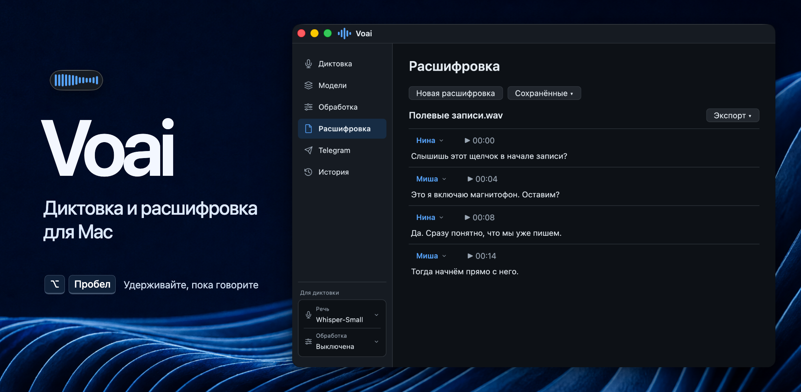

# Voai

Hold **⌥ Space** and speak. Release the keys and Voai types the words at your cursor, leaving your clipboard alone. Voai runs on **macOS 14 or later on Apple Silicon**.



## Features

- [x] 🎙️ **Dictate at the cursor.** Hold a shortcut to speak, then release it to insert the text. A single right Command key works too.
- [x] 🌊 **Choose your dictation widget.** See a live draft in the floating panel or just a waveform near the text field. Turn on local noise suppression when you need it.
- [x] 🎞️ **Transcribe audio and video.** Get plain text or a timestamped conversation. Play a turn, correct its speaker and export TXT or SRT.
- [x] ✍️ **Edit transcripts your way.** Write your own editing instructions and pick separate models for dictation and files. Run a GGUF model on your Mac, connect Ollama or LM Studio, or use an OpenAI or Anthropic API key.
- [x] ⌨️ **Use your Codex or Claude login.** Choose Codex CLI or Claude Code as the editor. Voai finds the executable automatically and lets you set its path, model and reasoning effort.
- [x] 📥 **Bring your own models.** Download verified weights in Voai or select compatible models already on your Mac.
- [x] 🕘 **Revisit recent dictations.** Play back the last 20 recordings, compare original and edited text, or copy either version. You can also copy the live draft from the floating panel.
- [x] 💬 **Transcribe Telegram messages.** Forward a voice note, audio file or video to your paired bot. Your Mac transcribes it and replies in the same private chat.
- [x] 🌐 **Switch between English and Russian.** Follow your Mac’s language or choose the interface and spoken language separately.
- [x] 🔄 **Update in the app.** Check for signed updates from the Voai menu.

## Where your speech goes

Whisper, Parakeet and GigaAM transcribe on your Mac using Metal. GigaAM specializes in Russian. Parakeet TDT v3 covers 25 European languages. Download a model in Voai or point it at one you already have. Once the models are on disk, speech recognition works offline.

Text editing is optional. Choosing a cloud editor for dictation or file transcription sends the editing instructions and recognized text to that provider. Audio stays on your Mac. The Telegram bot uses local speech recognition and optional GGUF editing.

## Try it

Download the DMG from [GitHub Releases](https://github.com/mozomig/Voai/releases), open it and drag Voai to Applications. The current release is distributed without Apple notarization. If macOS blocks the first launch, you can review Voai in **System Settings → Privacy & Security** after trying to open it. Voai checks for signed updates through Sparkle.

To build from source, you'll need Xcode with the Metal toolchain, CMake and a stable Rust toolchain that supports the 2024 edition.

```sh
git clone https://github.com/mozomig/Voai.git
cd Voai
./scripts/package-macos
open target/dist/release/Voai.app
```

The quick start walks you through microphone and Accessibility permissions, then opens the speech model picker. Try a phrase in the test field before switching to your editor. Voai follows your Mac's preferred language and lets you select English or Russian in settings. You can choose the language you dictate in separately.

[User guide](docs/usage.md) · [Build and release](docs/development.md) · [Architecture](ARCHITECTURE.md) · [Releases](https://github.com/mozomig/Voai/releases)
